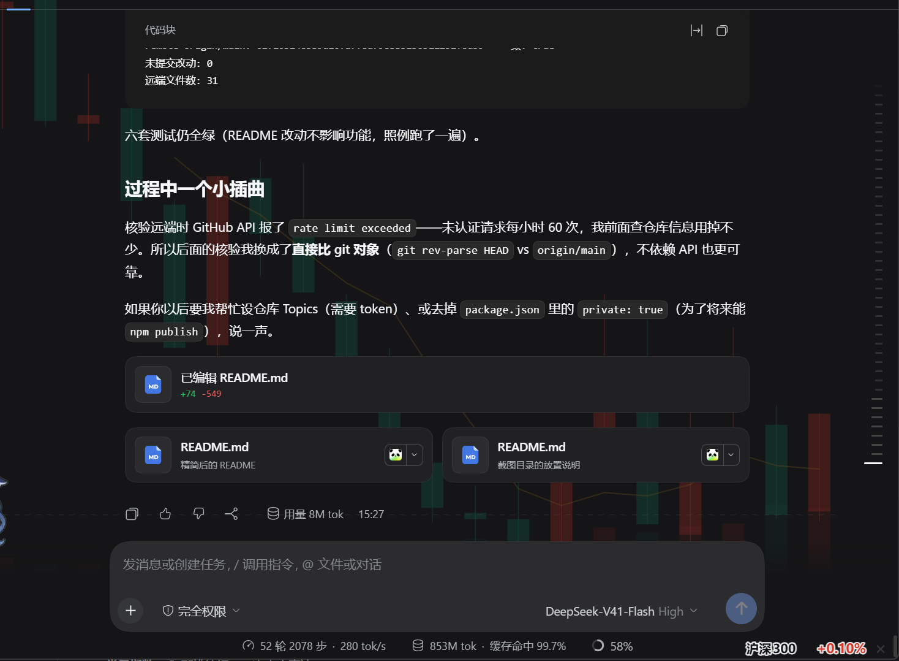
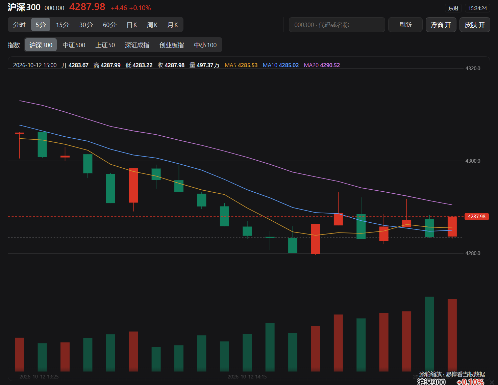

# 同花顺实时 K 线行情 · DSH 插件

在 [DeepSeek Harness](https://github.com/deepseek-ai) 界面里直接看实时 K 线 —— **炒股编码两不误**。

支持 **A 股 · 港股指数 · 美股指数**。同一个行情出现在三处：**行情主面板大图**、**对话页背景 K 线**、**右下角价格挂件**。


## 安装

**方式一：插件页**

DSH 的「插件」页 → 「添加插件」→ 粘贴仓库地址 → 安装 → 启用。

```
https://github.com/Mopemop/dsh-stock-kline
```

**方式二：让 Agent 装**

在对话里让 Agent 调用 `plugin_manager`，spec 就是上面那个地址。

装完**重启一次 DSH**，插件页里会出现 `dsh-stock-kline`，随时可以开关或卸载。

## 怎么用

### 三处显示

| 位置 | 说明 |
|---|---|
| **右下角价格挂件** | 透明的小标签，只有**名称 + 涨跌百分比**（红涨绿跌）。按住可拖动，双击回到右下角，鼠标移上去出现 `×` |
| **对话页背景 K 线** | K 线铺在对话内容底下，低透明度、鼠标穿透，不挡操作 |
| **行情主面板** | 整页大图 + 周期切换 + 搜索 + 快捷指数。**点右下角挂件**即可进入；左侧栏也有面板图标（如果那边没显示，就用挂件） |

对话背景和涨跌浮窗



主面板



### 主面板上方的三行

```
① 沪深300 000300   4287.98  +4.46 +0.10%        [东财] [15:34:24]
② [分时|5分|15分|30分|60分|日K|周K|月K]  │  [搜索框] [刷新] [浮窗 开] [皮肤 开]
③ 沪深 [沪深300][中证500][上证50][深证成指][创业板指][中小100]
   港股 [恒生指数][恒生科技]
   美股 [道琼斯][纳斯达克][标普500]
```

① 行情 —— 名称、代码、最新价、涨跌额与涨跌幅，右侧是**数据来源**和**更新时间**。

② 工具 —— 左边选周期，右边搜索 / 刷新 / 两个显示开关。

③ 快捷指数 —— 按市场分成 **沪深 / 港股 / 美股** 三组，点一下就切过去。
11 个指数字面上都列出来，是因为它们天天看、值得一次点击直达。

> 看美股指数时，② 里那四个分钟按钮会**置灰**：美股指数没有分钟级数据。
> 从别的周期切到美股指数时，周期会自动回落到**日 K**，不会把你丢在空图上。

### 选标的

- **常见指数**：③ 那三组按钮，一次点击直达（沪深 / 港股 / 美股）
- **其他股票**：② 的搜索框，输**代码** / **中文名** / **拼音**都行，输入即自动联想
  - `600519`、`贵州茅台`、`gzmt` 都能搜到贵州茅台
  - 结果列在下方，可直接点击，也可以 `↑` `↓` 选、回车确认
- **港股/美股指数**也可以直接输代码：`HSI`、`DJI`、`hkHSI`、`usDJI` 都认（不区分大小写）

### 看图

| 操作 | 效果 |
|---|---|
| 滚轮 | 缩放（可见根数 20 ~ 240 根） |
| 按住拖动 | 左右平移看历史 |
| 鼠标悬停 | 十字光标 + 当根数据的开高低收量 |

### 两个显示开关

面板上的 `浮窗` 和 `皮肤` 各自独立，**互不影响，也都不影响取数**：

| 开关 | 管什么 |
|---|---|
| `浮窗 开/关` | 右下角挂件显不显示（挂件关掉后，回面板的入口就是左侧栏图标或这里） |
| `皮肤 开/关` | 对话页铺不铺 K 线背景（设置 → 通用里也有同一个开关） |

### 刷新

**自动**，间隔跟随周期：

| 周期 | 间隔 |
|---|---|
| 分时 | 5 秒 |
| 5 分钟 | 10 秒 |
| 15 分钟 | 15 秒 |
| 30 / 60 分钟 | 30 秒 |
| 日 / 周 / 月 K | 60 秒 |

窗口切到后台时不取数，切回来立刻补一次。也可以点面板上的 `刷新` 手动补。

## 数据来源

| 标的 | 日 / 周 / 月 K | 分时 / 5·15·30·60 分 |
|---|---|---|
| A 股个股 | 同花顺 → 东方财富 → 腾讯 | 同花顺 → 东方财富 → 腾讯 |
| **A 股指数** | 东方财富 → 腾讯 | 东方财富 → 腾讯 |
| **港股指数** | **腾讯** | **腾讯** |
| **美股指数** | **腾讯** | **没有** |

几个实测出来的事实（都写进了测试，不是猜的）：

- 同花顺的 K 线接口对**指数**一律报错，而且会把 `000001` 当成深市个股返回「平安银行」——
  所以指数一律跳过它。
- 东财的接口会**限流**（短时间内请求多了直接拒连）。它是 A 股指数分时的主源，
  所以那条路挂了会自动落到腾讯，界面不会白屏。
- 美股指数只有腾讯一个源，而且**腾讯对它们只提供日/周/月 K**：分时接口只回一个点、
  分钟 K 线只回一根。所以看美股指数的分钟周期是置灰的。

响应里标的的实际来源就显示在面板右上角（`同花顺` / `东财` / `腾讯`），所以数据是从哪来的你一眼能看到。

**涨跌幅的基准**取的是图表里倒数第二根 K 线的收盘价，不是数据源给的"昨收"字段——某些源（尤其指数）那个字段和它自己的 K 线对不上，算出来会是明显错误的值。用图上的相邻两根算，和肉眼看到的永远自洽。

## 已知限制

- **搜索只服务个股。** 腾讯的搜索接口认不出 A 股指数（搜 `000300` 没结果，`000905` 还会搜到同名的「厦门港务」）。A 股指数请用面板上的快捷按钮；港股/美股指数也可以直接输 `HSI` / `DJI`。
- **美股指数没有分钟级数据。** 分时与 5/15/30/60 分钟都取不到（腾讯只提供日/周/月 K），所以那四个周期按钮对美股指数是置灰的，切过去时会自动落到日 K。港股指数不受此限，分钟数据正常。
- **数据只覆盖 A 股、港股指数、美股指数。** 港股/美股的**个股**不支持（会被过滤掉）。
- 数据来自第三方免费接口，**仅供看盘参考，不构成任何投资建议**。

## 许可

[MIT](LICENSE)
